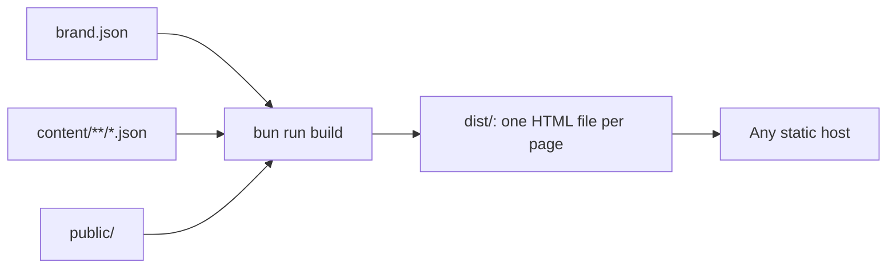

# quire documentation

quire is a template for documentation sites. Fork it once per application,
set the brand, and write pages as JSON.

| Guide                                 | Read it when                           |
| ------------------------------------- | -------------------------------------- |
| [Getting started](getting-started.md) | You are creating a docs site           |
| [Branding](branding.md)               | You are matching an application's look |
| [Writing content](content.md)         | You are adding or editing pages        |
| [Architecture](architecture.md)       | You are changing template code         |
| [CI and releases](ci-and-releases.md) | A check failed or you are shipping     |
| [Agent skill](agent-skill.md)         | You want an agent to build the site    |

