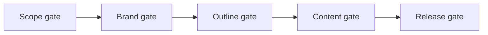

# Agent skill

The `docs-site` skill drives an agent through building a quire site for an
application. It lives in [`skills/docs-site`](../skills/docs-site/SKILL.md) and
in the [smeltery/skills](https://github.com/smeltery/skills) catalog.

```bash
npx skills@latest add smeltery/skills --skill docs-site
```

Then ask your agent: `/docs-site <app repo or path>`.

## Gates

The agent stops for your approval at each gate.



| Gate    | You approve                                                   |
| ------- | ------------------------------------------------------------- |
| Scope   | Application, readers, docs repo name, visibility, host        |
| Brand   | Name, logo, palette with contrast, screenshots beside the app |
| Outline | Page list and groups, each with its source                    |
| Content | Rendered pages and any open questions                         |
| Release | Each external action: repo creation, push, deploy             |

Progress is saved in `.docs-site/state.json`, so rerunning the command resumes
where it stopped.
