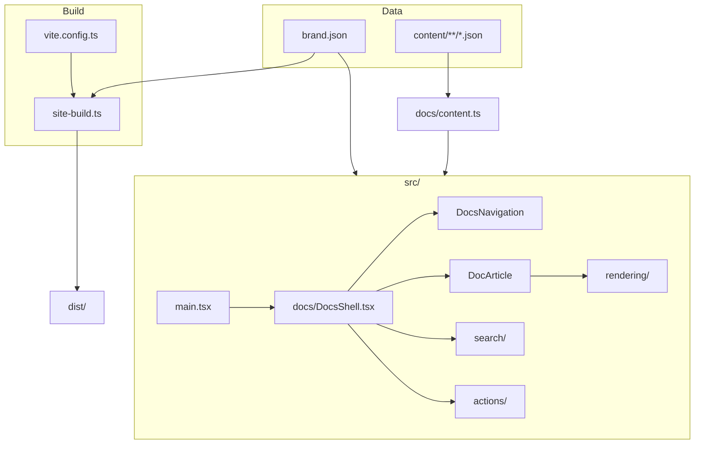

# Architecture

quire is a single Vite and React app with no runtime server.

## Modules

| Path                      | Responsibility                                        |
| ------------------------- | ----------------------------------------------------- |
| `src/brand.ts`            | Typed brand config and theme CSS                      |
| `src/docs/pages.ts`       | Page types, sorting, loading (pure; tested with Bun)  |
| `src/docs/content.ts`     | Vite glob over `content/` and `findPage`              |
| `src/docs/DocsShell.tsx`  | Header, sidebar, table of contents, footer, 404       |
| `src/docs/DocArticle.tsx` | Renders hero and section blocks                       |
| `src/docs/search/`        | Ranking (`index.ts`) and the ⌘K dialog                |
| `src/docs/actions/`       | Edit on GitHub, Copy as Markdown, Open in chat        |
| `src/docs/rendering/`     | Code highlighting, SVG diagrams, Mermaid export       |
| `site-build.ts`           | Head tags, theme injection, per-page HTML, `404.html` |
| `scripts/`                | Docs and LOC budget checks                            |

## Rules

- Data over code: a new application should need no `src/` changes.
- No file over 200 lines; the whole codebase stays under the total in
  [`scripts/budgets.json`](../scripts/budgets.json).
- Pure logic lives outside React components so `bun test` can import it.
