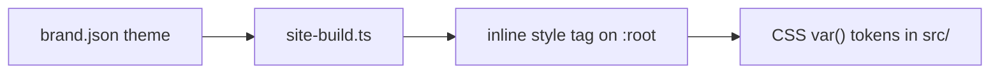

# Branding

All identity lives in [`brand.json`](../brand.json) and two SVGs in `public/`.
Template code reads these values; it never hardcodes a product name or color.

## Keys

| Key                    | Used for                                 |
| ---------------------- | ---------------------------------------- |
| `name`                 | Page titles, back links, AI chat prompt  |
| `wordmark`             | Header brand text                        |
| `description`          | Default meta description and 404 page    |
| `homepage`             | "Back to" and footer links               |
| `repository`, `branch` | GitHub link, Edit on GitHub, source link |
| `logo`, `ogImage`      | Header mark and favicon, social preview  |
| `nav`                  | Header links                             |
| `groups`               | Sidebar group order                      |
| `popular`              | Search results before typing             |
| `searchHint`           | Empty-search message                     |
| `theme`                | CSS custom properties                    |

## Theme tokens

Each `theme` key becomes `--<key>` on `:root`. The build injects them into every
HTML file, so pages render with the right colors before JavaScript loads.

| Token group                                   | Role                                   |
| --------------------------------------------- | -------------------------------------- |
| `ink`, `muted`, `subtle`                      | Text, from strongest to quietest       |
| `paper`, `surface`, `line`                    | Background, raised surfaces, hairlines |
| `accent`, `accent-ink`, `accent-mid`          | Focus, active text, diagram strokes    |
| `accent-soft`, `accent-line`, `accent-border` | Tinted fills and borders               |
| `button`, `button-hover`                      | Solid buttons                          |
| `font`                                        | Body font stack                        |

Keep text tokens at a 4.5:1 contrast ratio against `paper`. Method badges and
syntax colors are fixed so code reads the same across brands.

## Matching an existing application

Take values from the application's own tokens or computed styles, not from
screenshots. The [agent skill](agent-skill.md) automates this and records where
each value came from.
