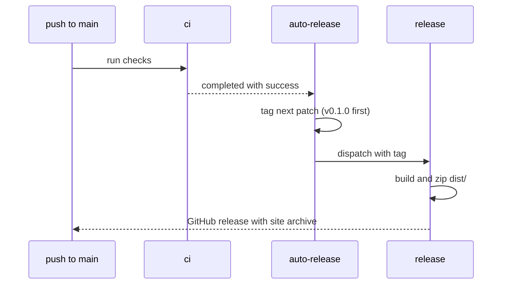

# CI and releases

One set of checks runs everywhere. The pre-commit hook and the `ci` workflow
both run [`.pre-commit-config.yaml`](../.pre-commit-config.yaml) inside Flox.

| Hook                                                            | Command                 |
| --------------------------------------------------------------- | ----------------------- |
| whitespace, end of file, YAML, JSON, merge markers, large files | pre-commit-hooks        |
| biome format                                                    | `bun run format:check`  |
| biome lint                                                      | `bun run lint`          |
| typecheck                                                       | `bun run typecheck`     |
| bun test                                                        | `bun run test`          |
| vite build                                                      | `bun run build`         |
| markdown, mermaid, links                                        | `bun run check:docs`    |
| LOC budgets                                                     | `bun run check:budgets` |
| actionlint                                                      | `actionlint`            |

`check:docs` lints every Markdown file, parses every Mermaid block in Markdown
and every diagram in `content/`, and checks relative links.

## LOC budgets

[`scripts/budgets.json`](../scripts/budgets.json) caps lines per file (200),
total code lines, and files per directory (15). Split a file before raising a
limit; when raising one, explain why in the pull request.

## Releases

`auto-release` bumps the patch version for every green commit on `main` and
skips commits that already carry a tag. For a minor or major release, push a
tag such as `v0.2.0` yourself; `release` runs on any `v*` tag.
