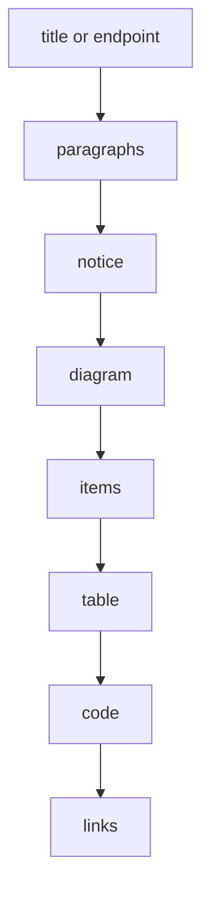

# Writing content

Pages are JSON files under [`content/`](../content). The `path` field sets the
URL; the folder layout is only for humans.

## Page shape

```json
{
  "path": "/docs/guides/install",
  "title": "Install",
  "group": "Guides",
  "description": "Install the CLI on macOS, Linux, or Windows.",
  "order": 1,
  "sections": [
    {
      "id": "macos",
      "title": "macOS",
      "paragraphs": ["Use Homebrew."],
      "code": "brew install acme",
      "language": "Terminal"
    }
  ]
}
```

The full field list is on the
[page schema](../content/reference/page-schema.json) page. A test rejects
unknown keys, duplicate paths or section ids, groups missing from
`brand.json`, broken card links, and diagram steps that name missing actors.

## Section blocks



Blocks render in that order. Leave out any you do not need.

## Diagrams

A sequence diagram is data: actors plus `[from, to, label]` steps. The site
draws it as SVG; Copy as Markdown and CI turn it into Mermaid.

```json
"diagram": {
  "title": "Login sequence",
  "actors": ["Browser", "API"],
  "steps": [[0, 1, "POST /login"], [1, 0, "Session cookie"]],
  "caption": "The API sets an HTTP-only cookie."
}
```

## Ordering and search

Pages sort by group (from `brand.json`), then `order`, then title. Search
indexes titles, descriptions, and every text block, and deep-links to the best
section. `popular` in `brand.json` sets the list shown before typing.
