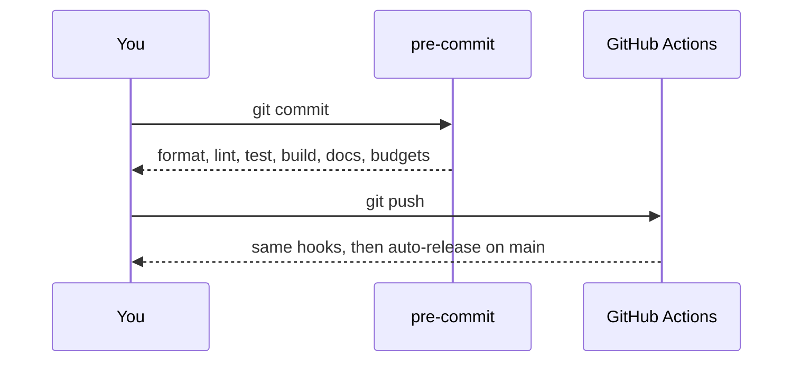

# Getting started

## Create a repository

```bash
gh repo create my-app-docs --template smeltery/quire --public --clone
cd my-app-docs
```

## Activate the environment

[Flox](https://flox.dev) pins Bun, pre-commit, actionlint, and shellcheck. The
first activation installs dependencies and the git hooks.

```bash
flox activate
bun run dev        # http://localhost:5173/docs
```

Without Flox, install Bun 1.3 or newer and run `bun install`. Install
[pre-commit](https://pre-commit.com) yourself to get the hooks.

## Daily commands

| Command           | Does                                         |
| ----------------- | -------------------------------------------- |
| `bun run dev`     | Dev server with hot reload                   |
| `bun run build`   | Type-check, bundle, and prerender to `dist/` |
| `bun run preview` | Serve `dist/` locally                        |
| `bun run ci`      | Every check CI runs                          |
| `bun run format`  | Apply Biome formatting                       |

## First changes

1. Edit [`brand.json`](../brand.json) and replace `public/logo.svg` and
   `public/og.svg`. See [Branding](branding.md).
2. Replace the sample pages in [`content/`](../content). See
   [Writing content](content.md).
3. Commit. The pre-commit hook runs the same checks as CI.


